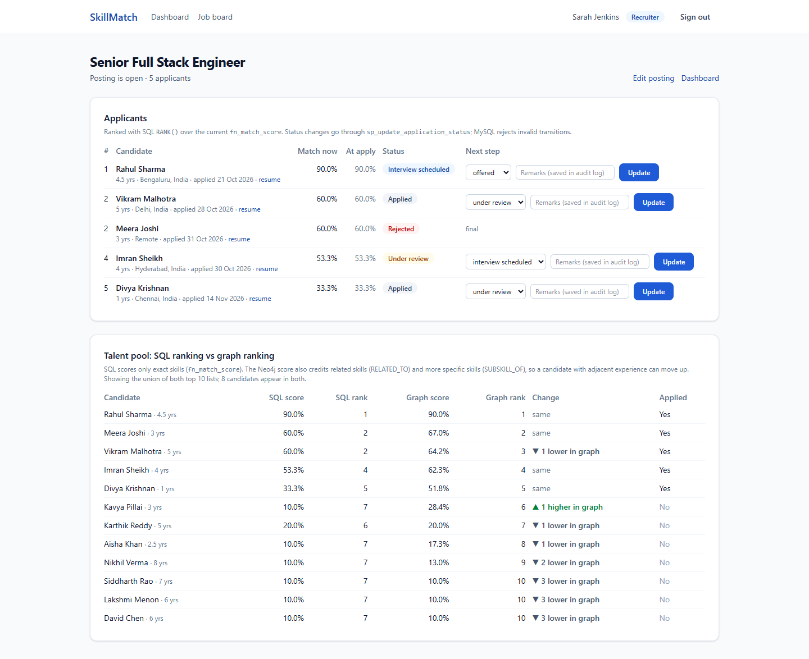

# SkillMatch: Intelligent Job & Skill Matching Platform

A job and skill matching platform built on **MySQL 8** (transactions, integrity, audit trail) and **Neo4j 5** (skill graph, recommendations), with a **Next.js 16** web app for candidates, recruiters and admins.
PES University · CSE · DBMS Experiential Learning, Level 3 Project.



**Highlights:**
- Weighted skill matching computed in SQL (`fn_match_score`) **and** in the graph (related and more specific skills); the exact scores agree on all 240 job × candidate pairs.
- A database-enforced application state machine, with an automatic audit trail written by triggers.
- An ACID application procedure with row locking: 3 concurrent identical submits → exactly one succeeds.
- A transactional outbox that keeps Neo4j in sync with MySQL: idempotent, ordered, verifiable.
- Role-based access (Candidate / Recruiter / Admin) checked in **every** API route.
- 51 SQL tests + 104 application tests, all passing.

## Documentation

| Document | Contents |
| :--- | :--- |
| [`docs/PROJECT_REPORT.md`](docs/PROJECT_REPORT.md) | **Main report:** objectives, requirements, DB justification, implementation, important queries, architecture, screenshots, test results, conclusion, contributions |
| [`docs/ER_DIAGRAM_AND_RELATIONAL_SCHEMA.md`](docs/ER_DIAGRAM_AND_RELATIONAL_SCHEMA.md) | ER diagram, relational schema, normalization, **data dictionary**, triggers and routines, graph model |
| [`docs/GRAPH_SYNC.md`](docs/GRAPH_SYNC.md) | MySQL → Neo4j outbox design, guarantees, eventual consistency |
| [`docs/RANKING_COMPARISON.md`](docs/RANKING_COMPARISON.md) | SQL vs Neo4j ranking, measured on all open jobs |
| [`docs/CONTRACTS.md`](docs/CONTRACTS.md) | API route table, error format, DB/graph contracts, file ownership per member |
| [`docs/screenshots/`](docs/screenshots/) | 17 screenshots of the running app |

## Repository layout

```
docker-compose.yml   MySQL 8 + Neo4j 5 (schema + seed load automatically on first start)
.env.example         configuration template - copy to .env (the only config file)
mysql/               01_schema · 02_seed_data · 03_queries_and_tests · 04_alter_demo · 05_performance · 06_tests
neo4j/               schema_and_seed.cql · queries.cql
web/                 Next.js app: app/ (pages + API routes) · lib/ (data access, auth, sync) · tests/ (Vitest)
docs/                report, schema, design notes, screenshots
```

## Setup and run

**Requirements:** Docker Desktop, Node.js ≥ 22.12.
The commands below work in Windows `cmd` (use `cp` instead of `copy` on macOS/Linux).

### 1. Configure
```cmd
copy .env.example .env
node -e "console.log(require('crypto').randomBytes(32).toString('hex'))"
notepad .env
```
In `.env`, set your own passwords and paste the generated value as `JWT_SECRET=`. **This one root `.env` is used by Docker and by the web app.** There is no `web/.env`, and no credentials are in the source code.

### 2. Start the databases
```cmd
docker compose up -d
docker compose ps
```
Wait until both containers show **(healthy)**. MySQL runs `01_schema.sql` and `02_seed_data.sql` automatically. Then seed the graph once:
```cmd
docker compose exec neo4j sh -c "cypher-shell -u neo4j -p \"$SM_NEO4J_PASSWORD\" -f /scripts/schema_and_seed.cql"
```

### 3. Start the web app
```cmd
cd web
npm install
npm run sync:graph
npm run dev
```
`npm run sync:graph` applies the pending MySQL changes to Neo4j and should end with `IN SYNC`. Then open **http://localhost:3000**. The health check is at http://localhost:3000/api/health.

**Demo accounts** (password `Password@123`):

| Role | Email | Try |
| :--- | :--- | :--- |
| Candidate | `meera.joshi@gmail.com` | *Jobs → Senior Full Stack Engineer*: SQL 60% vs graph 67%, skill gap, referral path |
| Candidate | `rahul.sharma@gmail.com` | *For you*: graph recommendations and "learn next" |
| Recruiter | `sarah.j@techcorp.com` | *Dashboard*, then a job's applicants: SQL vs graph ranking, move applicants through the pipeline |
| Admin | `admin@skillmatch.io` | Create recruiter accounts, manage skills, audit log, *Graph sync → Sync now & verify* |

### 4. Run the tests and demo scripts
```cmd
docker compose exec mysql sh -c "mysql -uroot -p\"$MYSQL_ROOT_PASSWORD\" -t < /scripts/06_tests.sql"
cd web
npm test
npm run typecheck
cd ..
```
`06_tests.sql` should end with `51 | 0 | 51 | ALL TESTS PASSED`, and `npm test` with `Tests 104 passed (104)`. The tests expect the demo data: reset first (step 6) if you have changed data by hand.

Demo scripts, each printing tables:
```cmd
docker compose exec mysql sh -c "mysql -uroot -p\"$MYSQL_ROOT_PASSWORD\" -t < /scripts/03_queries_and_tests.sql"
docker compose exec mysql sh -c "mysql -uroot -p\"$MYSQL_ROOT_PASSWORD\" -t < /scripts/04_alter_demo.sql"
docker compose exec mysql sh -c "mysql -uroot -p\"$MYSQL_ROOT_PASSWORD\" -t < /scripts/05_performance.sql"
docker compose exec neo4j sh -c "cypher-shell -u neo4j -p \"$SM_NEO4J_PASSWORD\" -f /scripts/queries.cql"
```
- `03_queries_and_tests.sql` runs the DML, joins, subqueries, window functions, full-text search and procedure demos. **It modifies data.**
- `04_alter_demo.sql` demonstrates ALTER / RENAME / DROP and undoes its changes.
- `05_performance.sql` runs EXPLAIN ANALYZE with and without each index.
- `queries.cql` runs the 7 graph queries.

### 5. Graph sync tools (in `web/`)
| Command | Effect |
| :--- | :--- |
| `npm run sync:graph` | Apply pending changes, then verify graph = MySQL |
| `npm run sync:graph -- --watch` | Keep syncing every 5 s (live demo) |
| `npm run sync:graph -- --full` | Rebuild mirrored graph data from MySQL, then sync |
| `npm run sync:graph -- --verify` / `--stats` | Compare only / outbox counts |

### 6. Reset to the demo data
```cmd
docker compose down -v
docker compose up -d
```
Then repeat the graph seed in step 2 and `npm run sync:graph` in step 3.

## Troubleshooting
| Problem | Fix |
| :--- | :--- |
| `failed to connect to the docker API` | Start Docker Desktop and wait for *Engine running* |
| Port 3306 already in use | Docker MySQL uses host port **3307** by default (`MYSQL_PORT` in `.env`) |
| `Invalid environment configuration … JWT_SECRET` | `JWT_SECRET` in `.env` must be at least 32 characters |
| `/api/health` says `degraded` | Containers not healthy yet: `docker compose ps` |
| `npm install` crashes with `edgesOut` | Use the provided `web/.npmrc`; npm ≥ 11 also works |
| Graph panels empty or stale | `cd web` then `npm run sync:graph` |

## Team
| Member | Responsibilities |
| :--- | :--- |
| *Member A: name (SRN)* | MySQL schema, constraints, triggers, procedures, performance and SQL tests; auth and RBAC; recruiter features |
| *Member B: name (SRN)* | Neo4j model and queries; outbox sync worker; candidate and admin features |

Each phase was built on its own branch and merged with `--no-ff`; see `git log --graph` and the [contributions section of the report](docs/PROJECT_REPORT.md#13-individual-contributions).
