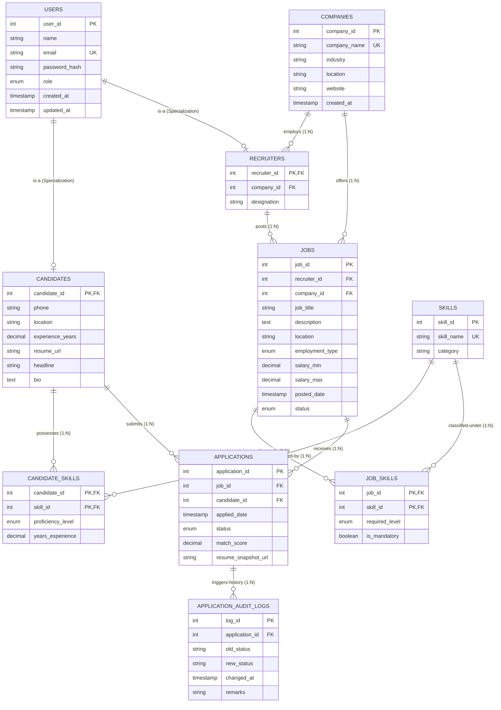
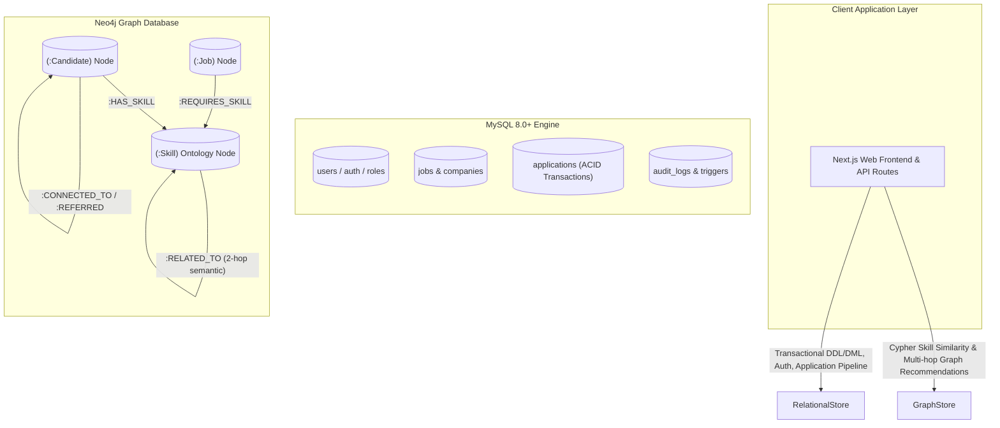

# SkillMatch: ER Diagram and Relational Schema Design Document

**Course:** DBMS Experiential Learning – Level 3 Project  
**Institution:** PES University, Department of Computer Science and Engineering  
**Project Title:** SkillMatch: Intelligent Multi-Paradigm Job & Skill Matching Platform  
**Architecture:** Polyglot Persistence (MySQL Relational DBMS + Neo4j Graph NoSQL DBMS)  

---

## 1. Relational Schema Specification

The relational schema for SkillMatch has been modeled in **Third Normal Form (3NF)** and **Boyce-Codd Normal Form (BCNF)** to eliminate data anomalies and ensure strict referential integrity.

### 1.1 Formal Notation

Primary keys are **underlined**, and Foreign keys are denoted with **asterisks (\*)** and referencing arrows.

1. **`users`** (
   <ins>`user_id`</ins>, 
   `name`, 
   `email`, 
   `password_hash`, 
   `role`, 
   `created_at`, 
   `updated_at`
)
   - *Key Constraints:* `user_id` (PK, Auto Increment), `email` (Unique, Check format).
   - *Domain Constraints:* `role` $\in$ `{'Candidate', 'Recruiter', 'Admin'}`.

2. **`candidates`** (
   <ins>`candidate_id`*</ins>, 
   `phone`, 
   `location`, 
   `experience_years`, 
   `resume_url`, 
   `headline`, 
   `bio`
)
   - *Key Constraints:* `candidate_id` (PK).
   - *Referential Integrity:* `candidate_id` $\rightarrow$ `users(user_id)` ON DELETE CASCADE.
   - *Domain Constraints:* `experience_years >= 0.0`.

3. **`companies`** (
   <ins>`company_id`</ins>, 
   `company_name`, 
   `industry`, 
   `location`, 
   `website`, 
   `created_at`
)
   - *Key Constraints:* `company_id` (PK, Auto Increment), `company_name` (Unique).

4. **`recruiters`** (
   <ins>`recruiter_id`*</ins>, 
   `company_id`*, 
   `designation`
)
   - *Key Constraints:* `recruiter_id` (PK).
   - *Referential Integrity:* 
     - `recruiter_id` $\rightarrow$ `users(user_id)` ON DELETE CASCADE.
     - `company_id` $\rightarrow$ `companies(company_id)` ON DELETE RESTRICT.

5. **`skills`** (
   <ins>`skill_id`</ins>, 
   `skill_name`, 
   `category`
)
   - *Key Constraints:* `skill_id` (PK, Auto Increment), `skill_name` (Unique).

6. **`candidate_skills`** (
   <ins>`candidate_id`*</ins>, 
   <ins>`skill_id`*</ins>, 
   `proficiency_level`, 
   `years_experience`
)
   - *Key Constraints:* Composite PK (`candidate_id`, `skill_id`).
   - *Referential Integrity:* 
     - `candidate_id` $\rightarrow$ `candidates(candidate_id)` ON DELETE CASCADE.
     - `skill_id` $\rightarrow$ `skills(skill_id)` ON DELETE CASCADE.
   - *Domain Constraints:* `proficiency_level` $\in$ `{'Beginner', 'Intermediate', 'Advanced', 'Expert'}`, `years_experience >= 0.0`.

7. **`jobs`** (
   <ins>`job_id`</ins>, 
   `recruiter_id`*, 
   `company_id`*, 
   `job_title`, 
   `description`, 
   `location`, 
   `employment_type`, 
   `salary_min`, 
   `salary_max`, 
   `posted_date`, 
   `status`
)
   - *Key Constraints:* `job_id` (PK, Auto Increment).
   - *Referential Integrity:* 
     - `recruiter_id` $\rightarrow$ `recruiters(recruiter_id)` ON DELETE RESTRICT.
     - `company_id` $\rightarrow$ `companies(company_id)` ON DELETE RESTRICT.
   - *Domain Constraints:* `employment_type` $\in$ `{'Full-time', 'Part-time', 'Contract', 'Internship', 'Remote'}`, `status` $\in$ `{'OPEN', 'CLOSED', 'ARCHIVED'}`, `salary_max >= salary_min >= 0`.

8. **`job_skills`** (
   <ins>`job_id`*</ins>, 
   <ins>`skill_id`*</ins>, 
   `required_level`, 
   `is_mandatory`
)
   - *Key Constraints:* Composite PK (`job_id`, `skill_id`).
   - *Referential Integrity:* 
     - `job_id` $\rightarrow$ `jobs(job_id)` ON DELETE CASCADE.
     - `skill_id` $\rightarrow$ `skills(skill_id)` ON DELETE CASCADE.
   - *Domain Constraints:* `required_level` $\in$ `{'Beginner', 'Intermediate', 'Advanced', 'Expert'}`, `is_mandatory` (Boolean).

9. **`applications`** (
   <ins>`application_id`</ins>, 
   `job_id`*, 
   `candidate_id`*, 
   `applied_date`, 
   `status`, 
   `match_score`, 
   `resume_snapshot_url`
)
   - *Key Constraints:* `application_id` (PK, Auto Increment), Candidate-Job Unique Constraint `(job_id, candidate_id)`.
   - *Referential Integrity:* 
     - `job_id` $\rightarrow$ `jobs(job_id)` ON DELETE CASCADE.
     - `candidate_id` $\rightarrow$ `candidates(candidate_id)` ON DELETE CASCADE.
   - *Domain Constraints:* `status` $\in$ `{'APPLIED', 'UNDER_REVIEW', 'INTERVIEW_SCHEDULED', 'OFFERED', 'REJECTED'}`, `match_score BETWEEN 0.00 AND 100.00`.

10. **`application_audit_logs`** (
    <ins>`log_id`</ins>, 
    `application_id`*, 
    `old_status`, 
    `new_status`, 
    `changed_at`, 
    `remarks`
)
    - *Key Constraints:* `log_id` (PK, Auto Increment).
    - *Referential Integrity:* `application_id` $\rightarrow$ `applications(application_id)` ON DELETE CASCADE.

---

## 2. Entity-Relationship (ER) Model

### 2.1 Entities and Relationships Description
- **Specialization / Generalization (ISA Hierarchy):**
  - Superclass: `USERS`
  - Subclasses: `CANDIDATES` and `RECRUITERS` (Disjoint, partial specialization).
- **Recruiter - Company:** Many-to-One (`RECRUITERS` work at `COMPANIES`).
- **Recruiter - Job:** One-to-Many (`RECRUITERS` post `JOBS`).
- **Company - Job:** One-to-Many (`COMPANIES` offer `JOBS`).
- **Candidate - Skill:** Many-to-Many resolved by associative entity `CANDIDATE_SKILLS` with attributes `proficiency_level` and `years_experience`.
- **Job - Skill:** Many-to-Many resolved by associative entity `JOB_SKILLS` with attributes `required_level` and `is_mandatory`.
- **Candidate - Job (Application):** Many-to-Many resolved by `APPLICATIONS` tracking application lifecycle state, automated match score, and timestamp.
- **Application - Audit Log:** One-to-Many (`APPLICATIONS` have status change history in `APPLICATION_AUDIT_LOGS`).

### 2.2 Chen ER / Crow's Foot Structural Diagram

---

## 3. Polyglot Persistence Architecture (Relational + Graph)

| Database | Paradigm | Storage Responsibility | Rationale |
| :--- | :--- | :--- | :--- |
| **MySQL 8.0+** | Relational (SQL) | User Auth, Company Profiles, Job Postings, Application Workflow, Audit Logs | Requires strict ACID transactions (`sp_submit_application`), foreign key constraints, and structured transactional reporting. |
| **Neo4j 5.0+** | Graph (NoSQL) | Candidate Skills, Job Skill Requirements, Skill Taxonomy (`[:RELATED_TO]`), Professional Referrals (`[:REFERRED]`, `[:WORKED_AT]`) | Multi-hop recursive graph traversal, skill ontology expansion (e.g., Python $\rightarrow$ PyTorch), and semantic candidate ranking. |

---

## 4. Normalization Analysis (Up to BCNF)

1. **First Normal Form (1NF):**
   - All attribute values are atomic (e.g., multi-valued candidate skills are extracted into `candidate_skills` rather than stored as comma-separated lists).
   - Every relation has a defined Primary Key.

2. **Second Normal Form (2NF):**
   - In composite primary key tables (`candidate_skills` with PK `{candidate_id, skill_id}` and `job_skills` with PK `{job_id, skill_id}`), all non-prime attributes (`proficiency_level`, `years_experience`, `required_level`, `is_mandatory`) depend fully on the complete composite key, not on any subset. No partial dependencies exist.

3. **Third Normal Form (3NF):**
   - Transitive dependencies are removed. In `jobs`, recruiter designation and company details are referenced by foreign keys `recruiter_id` and `company_id` rather than duplicating company details within the job table. Similarly, candidate profiles in `candidates` reference `users(user_id)`.

4. **Boyce-Codd Normal Form (BCNF):**
   - For every functional dependency $X \rightarrow Y$, $X$ is a superkey. In `applications`, the candidate and job pair is guarded by `UNIQUE(job_id, candidate_id)`, preventing duplicate submissions.

