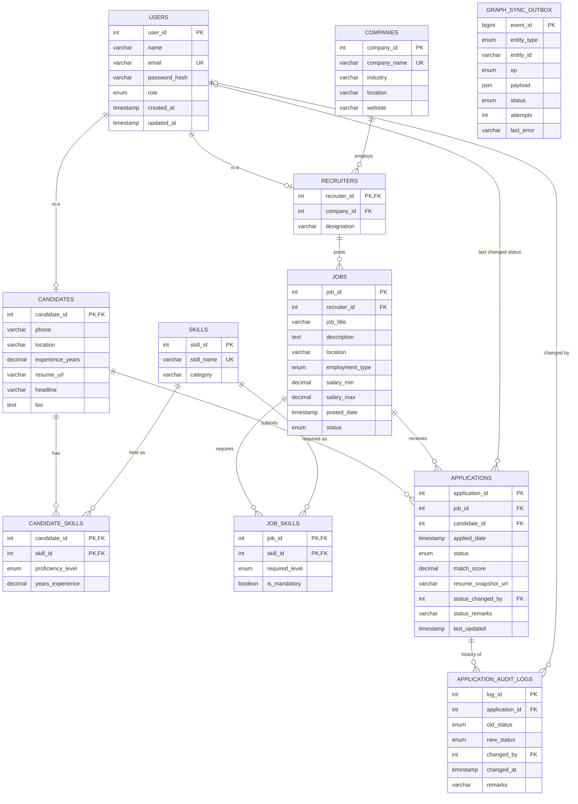
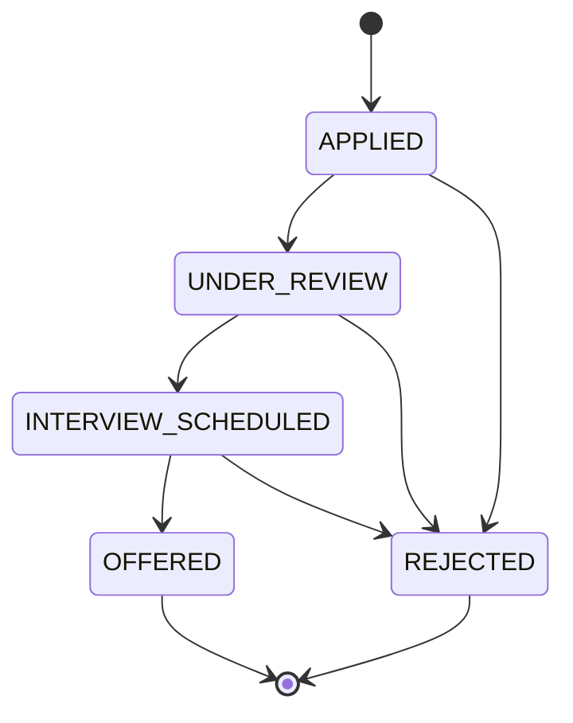

# SkillMatch: ER Diagram, Relational Schema & Data Dictionary

**Course:** DBMS Experiential Learning – Level 3 Project, PES University (CSE)
**Database:** MySQL 8.0 (relational, source of truth) + Neo4j 5 (graph)
**Implementation:** [`mysql/01_schema.sql`](../mysql/01_schema.sql), [`neo4j/schema_and_seed.cql`](../neo4j/schema_and_seed.cql)

The MySQL database has 11 tables, 5 views, 1 stored function, 3 stored procedures, 27 triggers, 12 CHECK constraints, 13 foreign keys and 17 secondary indexes (two of them FULLTEXT).

---

## 1. Entity–Relationship Model

### 1.1 Entities and relationships

| Relationship | Cardinality | Notes |
| :--- | :--- | :--- |
| USER is-a CANDIDATE / RECRUITER | 1 : 0..1 each | **Disjoint, partial specialization.** The subtype must match `users.role`, which triggers enforce. Admins have no subtype row. |
| RECRUITER works at COMPANY | N : 1 | |
| RECRUITER posts JOB | 1 : N | A job's company is **derived** through its recruiter (see §3) |
| CANDIDATE has SKILL | M : N | Associative entity `candidate_skills` (proficiency, years) |
| JOB requires SKILL | M : N | Associative entity `job_skills` (required level, mandatory) |
| CANDIDATE applies to JOB | M : N | Associative entity `applications` (status, match score), UNIQUE per pair |
| APPLICATION has AUDIT LOG entries | 1 : N | Written only by triggers |
| Business change produces OUTBOX event | 1 : N | Written only by triggers; consumed by the Neo4j sync worker |

### 1.2 Crow's-foot diagram

`GRAPH_SYNC_OUTBOX` has no foreign keys by design. Its events must outlive the rows they describe (a DELETE event refers to a row that no longer exists).

---

## 2. Relational Schema

Primary keys are <ins>underlined</ins>. Foreign keys are marked with `→ table(column) [ON DELETE action]`.

1. **users** (<ins>user_id</ins>, name, email, password_hash, role, created_at, updated_at)
2. **candidates** (<ins>candidate_id</ins> → users(user_id) [CASCADE], phone, location, experience_years, resume_url, headline, bio)
3. **companies** (<ins>company_id</ins>, company_name, industry, location, website, created_at)
4. **recruiters** (<ins>recruiter_id</ins> → users(user_id) [CASCADE], company_id → companies [RESTRICT], designation)
5. **skills** (<ins>skill_id</ins>, skill_name, category)
6. **candidate_skills** (<ins>candidate_id</ins> → candidates [CASCADE], <ins>skill_id</ins> → skills [CASCADE], proficiency_level, years_experience)
7. **jobs** (<ins>job_id</ins>, recruiter_id → recruiters [RESTRICT], job_title, description, location, employment_type, salary_min, salary_max, posted_date, status)
8. **job_skills** (<ins>job_id</ins> → jobs [CASCADE], <ins>skill_id</ins> → skills [CASCADE], required_level, is_mandatory)
9. **applications** (<ins>application_id</ins>, job_id → jobs [CASCADE], candidate_id → candidates [CASCADE], applied_date, status, match_score, resume_snapshot_url, status_changed_by → users [SET NULL], status_remarks, last_updated); UNIQUE (job_id, candidate_id)
10. **application_audit_logs** (<ins>log_id</ins>, application_id → applications [CASCADE], old_status, new_status, changed_by → users [SET NULL], changed_at, remarks)
11. **graph_sync_outbox** (<ins>event_id</ins>, entity_type, entity_id, op, payload, status, attempts, last_error, created_at, processed_at)

**Why these delete actions.**
- **CASCADE** for owned data: a candidate's skills and applications disappear with the candidate.
- **RESTRICT** where deleting would destroy business history: you can't delete a company that still has recruiters, or a recruiter who still has postings.
- **SET NULL** for "who did it" columns, so the audit trail survives when a user account is deleted.

---

## 3. Normalization (to 3NF / BCNF)

| Form | How the schema satisfies it |
| :--- | :--- |
| **1NF** | Every attribute is atomic. Multi-valued facts (a candidate's skills, a job's skills) live in `candidate_skills` and `job_skills`, never in comma-separated lists. Every relation has a primary key. |
| **2NF** | The tables with composite keys (`candidate_skills`, `job_skills`) have only attributes that depend on the **whole** key. A proficiency describes the (candidate, skill) pair, not either one alone. |
| **3NF** | **The original design stored both `jobs.recruiter_id` and `jobs.company_id`.** Since `recruiter_id → company_id` (recruiters table), that is the transitive dependency `job_id → recruiter_id → company_id`. It also let a job's company disagree with its recruiter's company. `jobs.company_id` was **removed**, and the company is always derived via `jobs → recruiters → companies`. Candidate and recruiter details are likewise kept only in their own tables and referenced by key. |
| **BCNF** | Every non-trivial functional dependency has a superkey on its left side. The only candidate keys besides the PKs are `users.email`, `skills.skill_name`, `companies.company_name` and `applications (job_id, candidate_id)`, and all are declared UNIQUE. |

**Documented trade-off.** Because the company is derived, a recruiter who moves to another company takes their existing postings with them. This is treated as a rare administrative action. The trigger `trg_outbox_recruiter_upd` re-syncs those jobs to Neo4j when it happens, and `trg_job_status_rules` forbids moving a job to another recruiter.

**Deliberate snapshot attributes (not redundancy).** `applications.match_score` and `applications.resume_snapshot_url` record the score and resume **at the time of applying**. They are historical facts, not copies of current data, so they don't break 3NF. The current score is always recomputed with `fn_match_score`.

---

## 4. Data Dictionary

### users: every account (superclass)
| Column | Type | Constraints | Description |
| :--- | :--- | :--- | :--- |
| user_id | INT | PK, AUTO_INCREMENT | Account id |
| name | VARCHAR(100) | NOT NULL, CHECK not blank | Display name |
| email | VARCHAR(150) | NOT NULL, UNIQUE `uk_users_email`, CHECK `REGEXP_LIKE` email format | Login |
| password_hash | VARCHAR(255) | NOT NULL | bcrypt hash (cost 10); never plain text |
| role | ENUM('Candidate','Recruiter','Admin') | NOT NULL, default Candidate | Can't change once a subtype row exists (trigger) |
| created_at / updated_at | TIMESTAMP | defaults, `ON UPDATE` | Audit timestamps |

### candidates: candidate profile (subtype of users)
| Column | Type | Constraints | Description |
| :--- | :--- | :--- | :--- |
| candidate_id | INT | PK, FK → users CASCADE | Same id as the user |
| phone | VARCHAR(20) | CHECK `^\+?[0-9 -]{7,20}$` or NULL | |
| location | VARCHAR(100) | | Mirrored to Neo4j |
| experience_years | DECIMAL(3,1) | NOT NULL, CHECK 0–60 | Mirrored to Neo4j |
| resume_url | VARCHAR(500) | CHECK starts with `http(s)://` or NULL | **Required to apply** (checked by `sp_submit_application`) |
| headline, bio | VARCHAR(150), TEXT | FULLTEXT `ft_candidates_profile` | Searchable profile text |

### companies
| Column | Type | Constraints | Description |
| :--- | :--- | :--- | :--- |
| company_id | INT | PK | |
| company_name | VARCHAR(150) | NOT NULL, UNIQUE | |
| industry | VARCHAR(100) | NOT NULL | |
| location | VARCHAR(100) | | |
| website | VARCHAR(200) | CHECK `http%://%` or NULL | |

### recruiters: recruiter profile (subtype of users)
| Column | Type | Constraints | Description |
| :--- | :--- | :--- | :--- |
| recruiter_id | INT | PK, FK → users CASCADE | Only users with role Recruiter (trigger) |
| company_id | INT | NOT NULL, FK → companies RESTRICT | The company every one of their jobs belongs to |
| designation | VARCHAR(100) | NOT NULL | |

### skills: skill taxonomy
| Column | Type | Constraints | Description |
| :--- | :--- | :--- | :--- |
| skill_id | INT | PK | Same id as the Neo4j `:Skill` node |
| skill_name | VARCHAR(80) | NOT NULL, UNIQUE, CHECK not blank | |
| category | VARCHAR(50) | NOT NULL | e.g. Languages, Frontend, DevOps |

### candidate_skills / job_skills: M:N associative entities
| Column | Type | Constraints | Description |
| :--- | :--- | :--- | :--- |
| candidate_id / job_id | INT | PK part, FK CASCADE | |
| skill_id | INT | PK part, FK → skills CASCADE | |
| proficiency_level / required_level | ENUM(Beginner, Intermediate, Advanced, Expert) | NOT NULL | Ordered scale used by `fn_match_score` |
| years_experience | DECIMAL(3,1) | CHECK 0–60 | candidate_skills only |
| is_mandatory | BOOLEAN | NOT NULL | job_skills only; mandatory skills weigh 2, optional 1 |

### jobs: postings
| Column | Type | Constraints | Description |
| :--- | :--- | :--- | :--- |
| job_id | INT | PK | Same id as the Neo4j `:Job` node |
| recruiter_id | INT | FK → recruiters RESTRICT; can't change (trigger) | Company is derived from here |
| job_title | VARCHAR(150) | NOT NULL, CHECK ≥ 3 chars | FULLTEXT `ft_jobs_text` (with description) |
| description | TEXT | NOT NULL | |
| location | VARCHAR(100) | NOT NULL | |
| employment_type | ENUM(Full-time, Part-time, Contract, Internship, Remote) | NOT NULL | |
| salary_min / salary_max | DECIMAL(12,2) | CHECK `salary_max >= salary_min >= 0` | INR per year |
| posted_date | TIMESTAMP | default now | Indexed with status |
| status | ENUM(OPEN, CLOSED, ARCHIVED) | OPEN ↔ CLOSED → ARCHIVED (terminal, trigger) | |

### applications
| Column | Type | Constraints | Description |
| :--- | :--- | :--- | :--- |
| application_id | INT | PK | |
| job_id, candidate_id | INT | FK CASCADE; UNIQUE pair; can't change (trigger) | |
| applied_date | TIMESTAMP | | |
| status | ENUM(APPLIED, UNDER_REVIEW, INTERVIEW_SCHEDULED, OFFERED, REJECTED) | always APPLIED on insert; transitions enforced by a trigger | State machine (§5) |
| match_score | DECIMAL(5,2) | CHECK 0–100; computed by trigger | Score at apply time |
| resume_snapshot_url | VARCHAR(500) | filled by trigger | Resume at apply time |
| status_changed_by / status_remarks | INT / VARCHAR(255) | FK → users SET NULL | Who and why for the latest change; read by the audit trigger (no session variables) |
| last_updated | TIMESTAMP | `ON UPDATE` | |

### application_audit_logs: immutable status history
| Column | Type | Description |
| :--- | :--- | :--- |
| log_id | INT PK | |
| application_id | INT FK CASCADE | |
| old_status / new_status | ENUM (same as applications.status) | `old_status` NULL for the creation entry |
| changed_by | INT FK → users SET NULL | Candidate on creation, recruiter/admin on later changes |
| changed_at | TIMESTAMP | |
| remarks | VARCHAR(255) | Supplied remarks, or an automatic description |

### graph_sync_outbox: MySQL → Neo4j events
| Column | Type | Description |
| :--- | :--- | :--- |
| event_id | BIGINT PK | Processing order |
| entity_type | ENUM(CANDIDATE, SKILL, CANDIDATE_SKILL, JOB, JOB_SKILL) | |
| entity_id | VARCHAR(64) | `'5'`, or `'5:12'` for composite keys |
| op | ENUM(UPSERT, DELETE) | |
| payload | JSON | Row snapshot at trigger time (NULL for DELETE) |
| status / attempts / last_error | ENUM(PENDING, DONE, FAILED) / INT ≥ 0 / VARCHAR | Worker bookkeeping; FAILED after 5 attempts |
| created_at / processed_at | TIMESTAMP | |

---

## 5. Constraints, Triggers and Routines

**Indexes** (beyond PKs and FKs): `idx_jobs_status_posted (status, posted_date DESC)`, `idx_apps_job_status`, `idx_apps_cand_status`, `idx_cand_skills_level`, `idx_outbox_status`, plus FULLTEXT `ft_jobs_text (job_title, description)` and `ft_candidates_profile (headline, bio)`. Their effect is measured in [`mysql/05_performance.sql`](../mysql/05_performance.sql).

**Application state machine** (`trg_validate_status_transition`):

| Trigger (27) | Purpose |
| :--- | :--- |
| `trg_candidate_role_check`, `trg_recruiter_role_check`, `trg_users_role_immutable` | Specialization integrity: the subtype must match the role, and the role can't change afterwards |
| `trg_prevent_apply_closed_job` | No applications to CLOSED/ARCHIVED or missing jobs |
| `trg_application_insert_defaults` (`FOLLOWS` the previous one) | Status = APPLIED; the match score and resume snapshot are computed by the DB |
| `trg_log_application_insert`, `trg_audit_application_status_update` | Audit trail on creation and on every status change |
| `trg_validate_status_transition` | State machine above; job_id and candidate_id can't change |
| `trg_job_status_rules` | ARCHIVED jobs can't be reopened; jobs can't change recruiter |
| 17 × `trg_outbox_*` | Write a sync event in the same transaction as each change to mirrored data |

| Routine | Kind | Purpose |
| :--- | :--- | :--- |
| `fn_match_score(candidate, job)` | Function | Weighted skill match 0–100 (mandatory ×2; credit = min(candidate level ÷ required level, 1)) |
| `sp_submit_application` | Procedure + transaction | Validates the candidate/resume and the job (`SELECT … FOR UPDATE`), checks for duplicates, inserts; OUT status code |
| `sp_update_application_status` | Procedure + transaction | Validates the status and the actor (owning recruiter or admin), updates with remarks; the triggers audit it |
| `sp_get_recruiter_analytics` | Procedure, 2 result sets | Per-job funnel (GROUP BY) + hard-to-fill skills (HAVING) |

---

## 6. Graph Model (Neo4j)

| Element | Properties | Source |
| :--- | :--- | :--- |
| `(:Candidate)` | id (unique), name, location, experience_years | Mirrored from `candidates` + `users` |
| `(:Job)` | id (unique), title, location, status (indexed) | Mirrored from `jobs` |
| `(:Skill)` | id (unique), name (unique), category (indexed) | Mirrored from `skills` |
| `(:Company)` | id (unique), name, industry, location | Mirrored from `companies` |
| `[:HAS_SKILL {proficiency, years}]`, `[:REQUIRES_SKILL {required_level, is_mandatory}]`, `[:OFFERED_BY]` | | Mirrored |
| `[:RELATED_TO {weight}]`, `[:SUBSKILL_OF]` | | Graph-only skill ontology |
| `[:WORKED_AT {since}]`, `[:CONNECTED_TO]` | | Graph-only professional network |

How MySQL changes reach Neo4j, and the consistency guarantees involved, are covered in [`GRAPH_SYNC.md`](GRAPH_SYNC.md).
