# SkillMatch: Intelligent Job & Skill Matching Platform

**Project report: DBMS Experiential Learning, Level 3 Project**
Department of Computer Science and Engineering, PES University · Faculty: Dr. Nagasundari S

| Team member | SRN | Role in this report |
| :--- | :--- | :--- |
| Sri Pranav Gautam Buduguru (Member A) | PES1UG24CS466 | Relational core, API foundation, recruiter features |
| Skanda Shyam Nadig (Member B) | PES1UG24CS458 | Graph database, synchronisation, candidate & admin features |

**Stack:** MySQL 8.0 (relational, source of truth) · Neo4j 5 (graph) · Next.js 16 (App Router, route handlers) · TypeScript · Docker Compose

---

## Contents
1. [Objectives](#1-objectives)
2. [Functional requirements](#2-functional-requirements)
3. [ER diagram](#3-er-diagram)
4. [Relational schema](#4-relational-schema)
5. [Database choice and justification](#5-database-choice-and-justification)
6. [Data dictionary](#6-data-dictionary)
7. [SQL / NoSQL implementation](#7-sql--nosql-implementation)
8. [Important queries](#8-important-queries)
9. [System architecture](#9-system-architecture)
10. [Application screenshots](#10-application-screenshots)
11. [Testing results](#11-testing-results)
12. [Conclusion](#12-conclusion)
13. [Individual contributions](#13-individual-contributions)
14. [Requirement → implementation map](#14-requirement--implementation-map)

---

## 1. Objectives

Keyword job boards miss candidates whose experience is *adjacent* to a job's requirements, and recruiters lose track of where each applicant stands. SkillMatch addresses both:

1. **Match candidates to jobs by skills**, with an exact, explainable score (MySQL) and a graph score that also credits related and more specific skills (Neo4j).
2. **Run the hiring pipeline with integrity:** applications move through a database-enforced state machine, every change is audited automatically, and concurrent submissions can't create duplicates.
3. **Keep two databases consistent** with a transactional outbox, so each database is used for what it does best without dual-write bugs.
4. **Give each role a web interface** (candidate, recruiter, admin), with authorization checked on the server in every API route.

## 2. Functional requirements

| Role | Requirement | Where |
| :--- | :--- | :--- |
| Visitor | Browse and full-text search open jobs; filter by location, type, salary, skill; register as a candidate | `/jobs`, `/register` |
| Candidate | See a personal match score (SQL) and graph score per job, a skill-gap table, related-skill paths and referral paths | `/jobs/[id]` |
| Candidate | Apply (atomic, validated: resume required, job open, no duplicates) | `POST /api/jobs/[id]/apply` → `sp_submit_application` |
| Candidate | Track applications with a full status timeline; manage skills and profile | `/me/applications`, `/me/skills`, `/me/profile` |
| Candidate | Job recommendations and "learn next" skills from the skill graph | `/me/recommendations` |
| Recruiter | Dashboard: KPIs, per-job pipeline, hiring funnel, hard-to-fill skills | `/recruiter` |
| Recruiter | Create/edit/close/archive own postings with required skills | `/recruiter/jobs/new`, `/recruiter/jobs/[id]/edit` |
| Recruiter | Review applicants (ranked), move them through the pipeline with remarks; compare SQL vs graph ranking | `/recruiter/jobs/[id]/applicants` |
| Admin | Create **recruiter and admin accounts** (the only way these roles exist); manage the skill taxonomy | `/admin/users`, `/admin/skills` |
| Admin | Inspect the audit trail; monitor and repair MySQL → Neo4j sync | `/admin/audit`, `/admin/outbox` |

**Non-functional:**
- Validation is enforced **in the database**, not only in the UI.
- No credentials are in source code; everything comes from environment variables.
- The app talks to the databases only through server-side API routes.
- Behaviour is covered by automated tests.

## 3. ER diagram

The full crow's-foot diagram, cardinalities and the application state machine are in [`ER_DIAGRAM_AND_RELATIONAL_SCHEMA.md`](ER_DIAGRAM_AND_RELATIONAL_SCHEMA.md#1-entityrelationship-model). In summary:

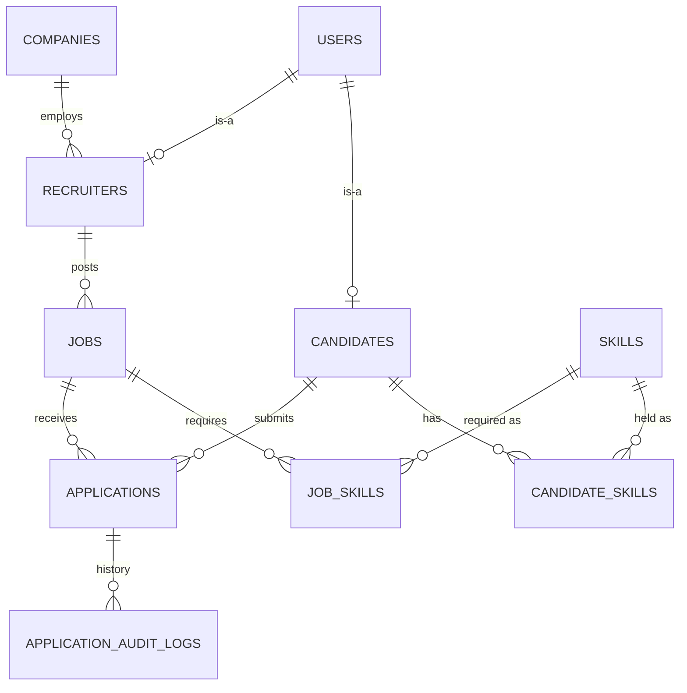

- **Specialization:** USERS → CANDIDATES / RECRUITERS is disjoint and partial (admins have no subtype). Triggers make sure the subtype matches `users.role`.
- **Associative entities:** three M:N relationships carry their own attributes: `candidate_skills` (proficiency, years), `job_skills` (required level, mandatory) and `applications` (status, match score).

## 4. Relational schema

11 relations in 3NF/BCNF (formal notation, keys, FK actions and the normalization analysis are in [`ER_DIAGRAM_AND_RELATIONAL_SCHEMA.md` §2–3](ER_DIAGRAM_AND_RELATIONAL_SCHEMA.md#2-relational-schema)):

`users`, `candidates`, `companies`, `recruiters`, `skills`, `candidate_skills`, `jobs`, `job_skills`, `applications`, `application_audit_logs`, `graph_sync_outbox`.

**A design correction made during the project:** the first version stored `jobs.company_id` as well as `jobs.recruiter_id`. Because `recruiter_id → company_id`, that was a transitive dependency (a 3NF violation), and it allowed a job's company to contradict its recruiter's. The column was removed; the company is derived through the recruiter.

## 5. Database choice and justification

Each kind of data is stored where its access pattern fits best (the PDF's §17 requirement):

| Data | Stored in | Why this database |
| :--- | :--- | :--- |
| Accounts, roles, passwords | MySQL | Needs uniqueness (email), referential integrity with profiles, transactional updates |
| Jobs, applications, pipeline status | MySQL | Strict integrity: one application per candidate per job, a valid state machine, no lost updates under concurrency (`SELECT … FOR UPDATE`), atomic multi-row writes |
| Audit trail | MySQL (triggers) | Must be written in the **same transaction** as the change it records; it can't be forgotten by application code |
| Aggregated dashboards | MySQL views, procedure | Set-based aggregation (GROUP BY / HAVING / window functions) over normalized data |
| Free-text search over postings and profiles | MySQL FULLTEXT | Ranked text search over data already in MySQL; the optimizer cost is 0.35 vs 5,084 for `LIKE '%…%'` (§11.3) |
| Skill ontology (related / more specific skills), professional network | **Neo4j only** | Multi-hop, weighted, variable-length traversal (`RELATED_TO*1..2`, `shortestPath`). In SQL this means recursive self-joins whose cost grows with path length; in a graph it is a direct pointer walk |
| Candidates, jobs, skills *as graph nodes* | Neo4j (mirror) | Needed as traversal endpoints; **MySQL stays the source of truth** and changes flow in through the outbox |

**Why not a vector database (Option 2)?** Our matching signal is a **curated, explainable** skill graph (a recruiter can see *why*: "GraphQL is related to Node.js, weight 0.7") rather than free-text similarity. Free-text search over postings is covered by MySQL FULLTEXT.

## 6. Data dictionary

The complete column-level dictionary (type, constraints, meaning for every column of all 11 tables) is in [`ER_DIAGRAM_AND_RELATIONAL_SCHEMA.md` §4](ER_DIAGRAM_AND_RELATIONAL_SCHEMA.md#4-data-dictionary). The graph model (labels, properties, relationship types, which are mirrored and which are graph-only) is in [§6 there](ER_DIAGRAM_AND_RELATIONAL_SCHEMA.md#6-graph-model-neo4j).

## 7. SQL / NoSQL implementation

### 7.1 MySQL (`mysql/`)

| Script | Contents |
| :--- | :--- |
| `01_schema.sql` | DDL: 11 tables, 12 CHECK constraints, 13 foreign keys, 17 secondary indexes incl. 2 FULLTEXT, 5 views, 1 function, 3 procedures, 27 triggers |
| `02_seed_data.sql` | 27 users (real bcrypt hashes), 6 companies, 26 skills, 15 jobs, 41 applications advanced **through the stored procedure**, so audit rows and outbox events come from the real triggers |
| `03_queries_and_tests.sql` | DML (INSERT/UPDATE/DELETE/SELECT), JOINs, GROUP BY/HAVING, subqueries (relational division, correlated), views, procedures, window functions, CTEs (incl. recursive), FULLTEXT, SQL ranking |
| `04_alter_demo.sql` | ALTER TABLE (add/modify/rename column, add/drop CHECK and index), ALTER VIEW, RENAME TABLE, DROP; self-reverting |
| `05_performance.sql` | `EXPLAIN ANALYZE` with vs without each index on 50,000 jobs / 100,000 applications |
| `06_tests.sql` | 51 self-checking PASS/FAIL tests |

**Advanced concepts (the PDF requires ≥ 4 for SQL):**

| Concept | Implementation |
| :--- | :--- |
| **Transactions** | `sp_submit_application`: START TRANSACTION, `SELECT … FOR UPDATE` on the job row, explicit ROLLBACK paths, an exit handler for duplicate-key races. The app layer also uses multi-statement transactions (registration, profile update, job + skills) |
| **Stored procedures and functions** | `sp_submit_application` (OUT status codes), `sp_update_application_status` (authorization inside the DB: owning recruiter or admin), `sp_get_recruiter_analytics` (two result sets), `fn_match_score` |
| **Triggers** | 27: state machine, subtype/role integrity, job lifecycle, DB-computed defaults, audit trail, outbox |
| **Views** | `vw_job_listings`, `vw_recruiter_pipeline`, `vw_candidate_applications`, `vw_top_demanded_skills`, `vw_job_match_leaderboard` (window function) |
| **Indexing** | Composite B-tree indexes matched to the app's queries, measured with EXPLAIN ANALYZE |
| **Full-text search** | `ft_jobs_text`, `ft_candidates_profile`; boolean-mode prefix search with operator sanitising |

**Pool-safe auditing.** Who changed an application status, and why, travels in the row itself (`status_changed_by`, `status_remarks`), not in session variables. With a connection pool, a session variable set by one request can leak into another request's audit row.

### 7.2 Neo4j (`neo4j/`)

- `schema_and_seed.cql` sets up 5 uniqueness constraints and 3 indexes, and seeds the graph with idempotent `MERGE`/`UNWIND`. The result is 67 nodes, 94 `HAS_SKILL`, 63 `REQUIRES_SKILL`, 15 `OFFERED_BY`, 27 `RELATED_TO`, 10 `SUBSKILL_OF`, 8 `WORKED_AT` and 15 `CONNECTED_TO`.
- `queries.cql` holds 7 parameterised queries: skill gap, related-skill credit, graph ranking, referral path, recommendations, supply/demand **aggregation** (`COUNT {}`, `COLLECT {}`), and "learn next".
- **The NoSQL advanced concepts used** are variable-length weighted traversal, `shortestPath` and graph aggregation.

### 7.3 Keeping the two databases consistent

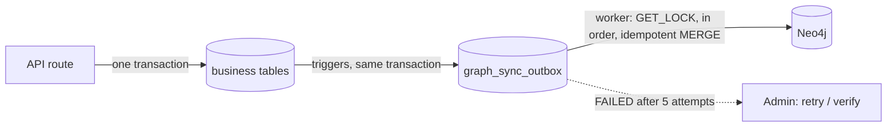

- **Delivery:** at-least-once, made safe by idempotent writes.
- **Ordering:** one worker at a time (MySQL advisory lock), and a failing event stops the batch so later events can't overtake it.
- **Consistency:** eventual, documented.
- **Tooling:** full rebuild and record-by-record verification are built in.
- **Details:** [`GRAPH_SYNC.md`](GRAPH_SYNC.md).

## 8. Important queries

**Relational division: candidates holding *all* mandatory skills of a job** (`03_queries_and_tests.sql` C1)
```sql
SELECT u.name FROM candidates cd JOIN users u ON u.user_id = cd.candidate_id
WHERE NOT EXISTS (SELECT 1 FROM job_skills js
                  WHERE js.job_id = 1 AND js.is_mandatory
                    AND js.skill_id NOT IN (SELECT cs.skill_id FROM candidate_skills cs
                                            WHERE cs.candidate_id = cd.candidate_id));
```

**Ranking candidates with a window function over a stored function** (`lib/recruiter.ts`, `vw_job_match_leaderboard`)
```sql
SELECT t.*, RANK() OVER (ORDER BY t.score DESC) AS sql_rank
FROM (SELECT candidate_id, fn_match_score(candidate_id, ?) AS score FROM candidates) t;
```

**Hiring funnel from the audit trail: applications that ever reached each stage** (`lib/recruiter.ts`)
```sql
SELECT l.new_status AS stage, COUNT(DISTINCT l.application_id) AS reached
FROM application_audit_logs l JOIN applications a USING (application_id)
JOIN jobs j ON j.job_id = a.job_id
WHERE j.recruiter_id = ? GROUP BY l.new_status;
```

**Full-text search with relevance** (`lib/jobs.ts`; user input is sanitised to `term*` prefixes)
```sql
SELECT job_id, MATCH(job_title, description) AGAINST (? IN BOOLEAN MODE) AS relevance
FROM jobs WHERE status = 'OPEN' AND MATCH(job_title, description) AGAINST (? IN BOOLEAN MODE)
ORDER BY relevance DESC;
```

**Hard-to-fill skills with GROUP BY … HAVING** (inside `sp_get_recruiter_analytics`)
```sql
SELECT s.skill_name, COUNT(cs.candidate_id) AS qualified_candidates
FROM jobs j JOIN job_skills js ON js.job_id = j.job_id AND js.is_mandatory
JOIN skills s ON s.skill_id = js.skill_id
LEFT JOIN candidate_skills cs ON cs.skill_id = js.skill_id
     AND FIELD(cs.proficiency_level, 'Beginner','Intermediate','Advanced','Expert')
      >= FIELD(js.required_level,   'Beginner','Intermediate','Advanced','Expert')
WHERE j.recruiter_id = ? AND j.status = 'OPEN'
GROUP BY j.job_id, s.skill_id, s.skill_name HAVING qualified_candidates < 3;
```

**Cypher: related-skill credit for a missing requirement** (`lib/graph-queries.ts`)
```cypher
MATCH (c:Candidate {id: $cid}), (j:Job {id: $jid})-[req:REQUIRES_SKILL]->(need:Skill)
WHERE NOT (c)-[:HAS_SKILL]->(need)
OPTIONAL MATCH p = (c)-[:HAS_SKILL]->(:Skill)-[:RELATED_TO*1..2]-(need)
RETURN need.name, reduce(x = 1.0, r IN relationships(p)[1..] | x * r.weight) AS similarity
```

**Cypher: referral path to the hiring company**
```cypher
MATCH (c:Candidate {id: $cid}), (:Job {id: $jid})-[:OFFERED_BY]->(co:Company),
      (ref:Candidate)-[:WORKED_AT]->(co) WHERE ref <> c
MATCH p = shortestPath((c)-[:CONNECTED_TO*1..3]-(ref))
RETURN ref.name, length(p), [n IN nodes(p) | n.name];
```

## 9. System architecture

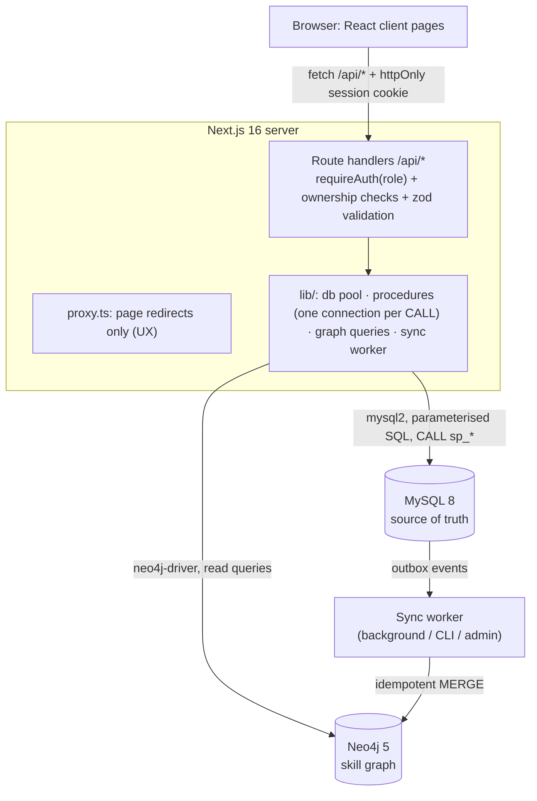

**Security design:**
- Passwords are stored as bcrypt hashes.
- Sessions are HS256 JWTs in an `httpOnly`, `SameSite=Lax` cookie.
- **Every protected API route checks the role itself**, and re-reads the user from MySQL (deleted users and stale roles are rejected). `proxy.ts` only redirects pages.
- Recruiter ownership is checked in the route **and again inside `sp_update_application_status`**.
- Public registration can only create Candidates.
- All SQL is parameterised, and running several SQL statements in one call is disabled.
- Credentials live only in the root `.env` (git-ignored).

## 10. Application screenshots

All screenshots are of the running app on the seeded demo data (`docs/screenshots/`).

| | |
| :--- | :--- |
| **Job detail: SQL vs graph match, skill gap, related skills, referral** 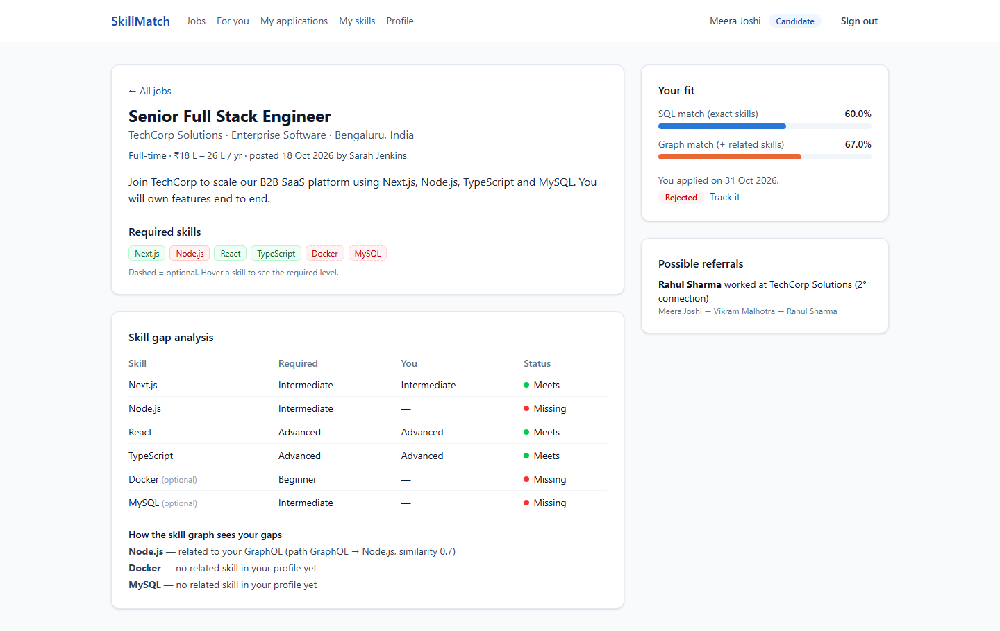 | **Job board: full-text search and personal match** 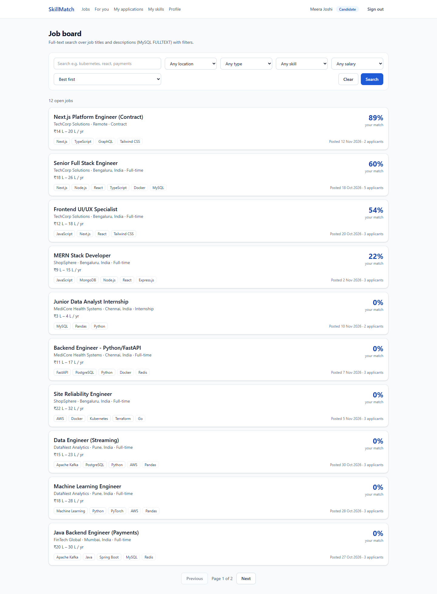 |
| **Graph recommendations and "learn next"** 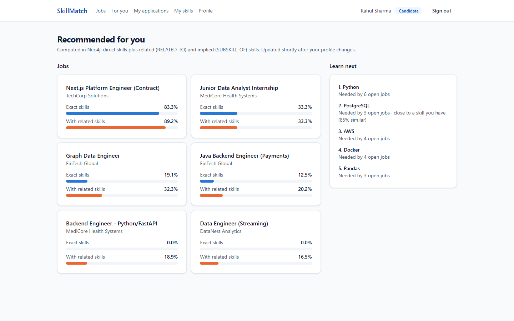 | **Application timeline from the audit trigger** 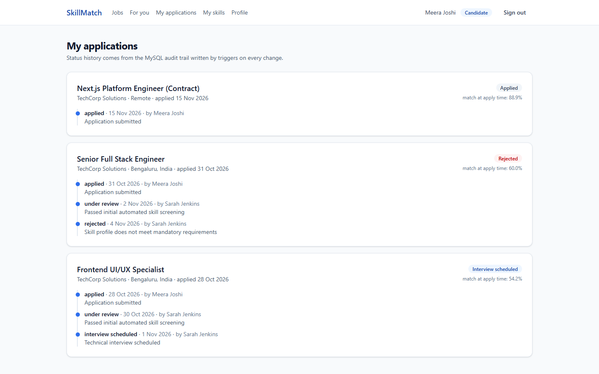 |
| **Recruiter dashboard: KPIs, funnel, hard-to-fill skills** 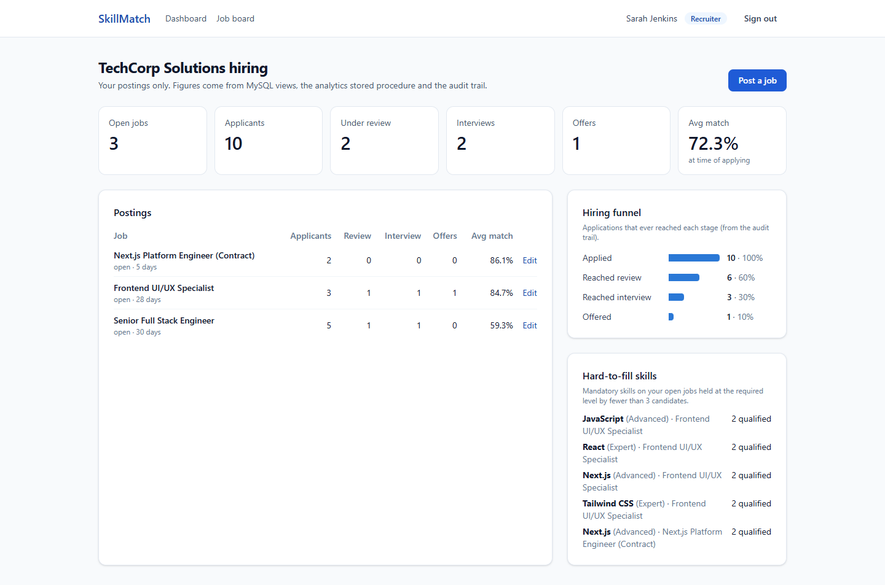 | **Applicants + SQL vs graph ranking** 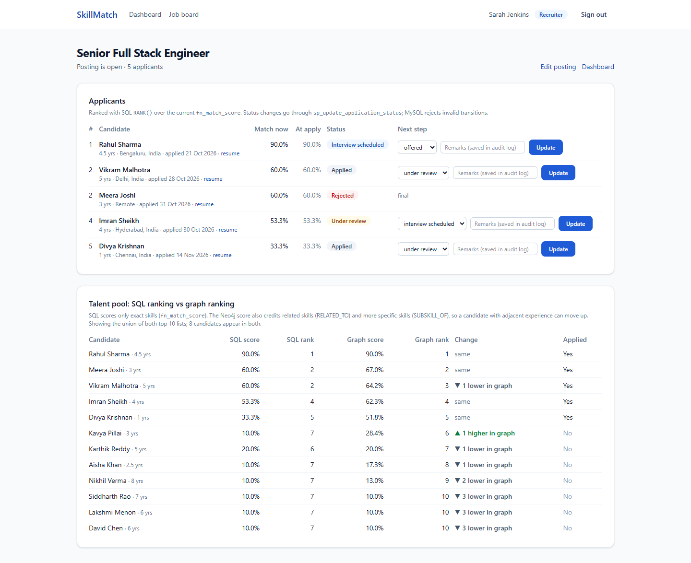 |
| **DB-level validation: CHECK `chk_salary_range`** 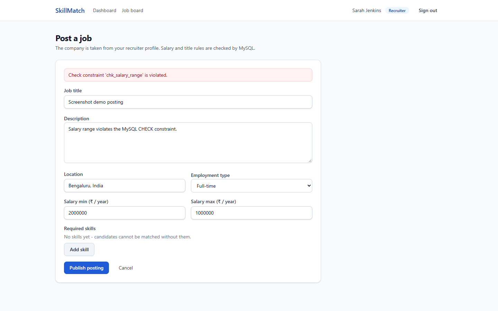 | **DB-level validation: CHECK `chk_candidate_phone`** 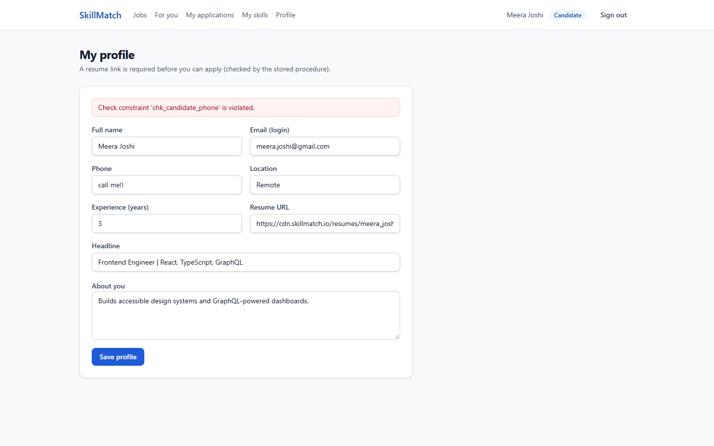 |
| **Admin overview (view `vw_top_demanded_skills`)** 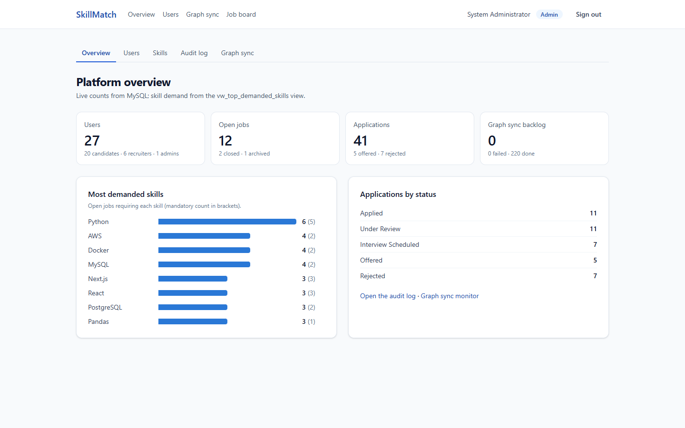 | **Graph sync monitor: "Sync now & verify"** 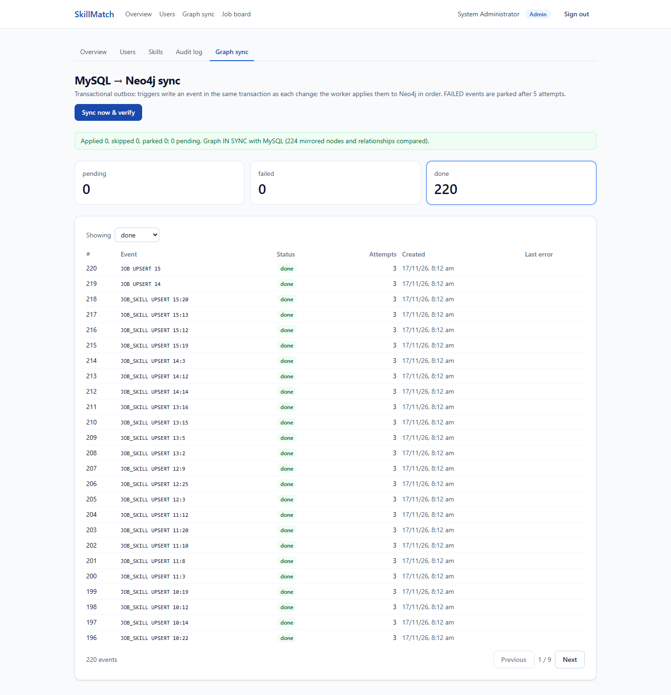 |
| **Audit log (trigger-written)** 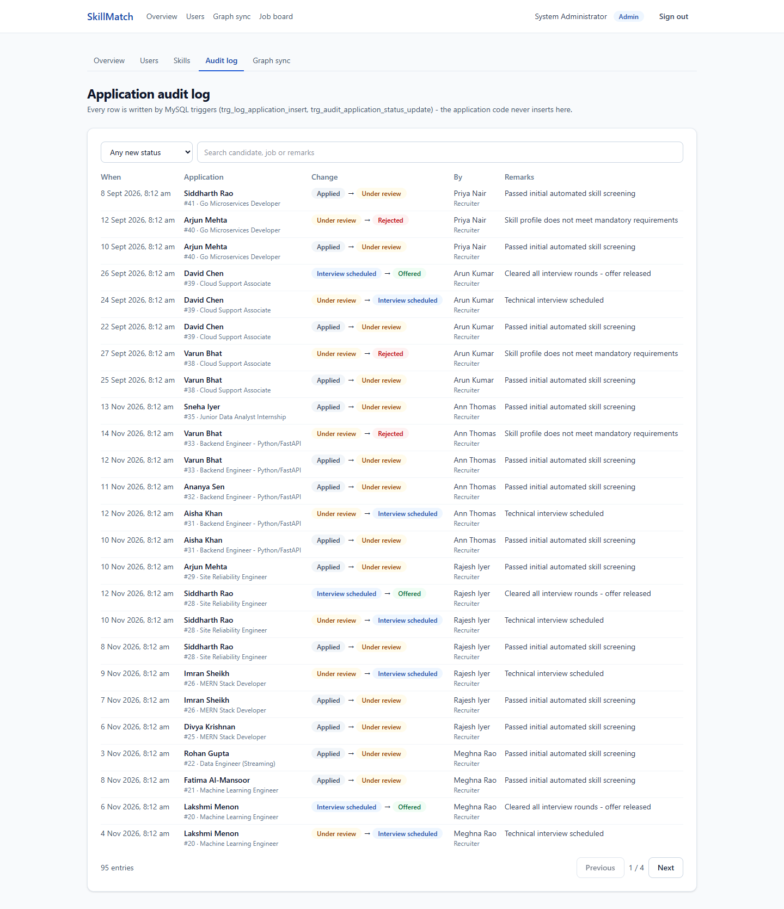 | **Role-based access: candidate sent away from `/recruiter`** 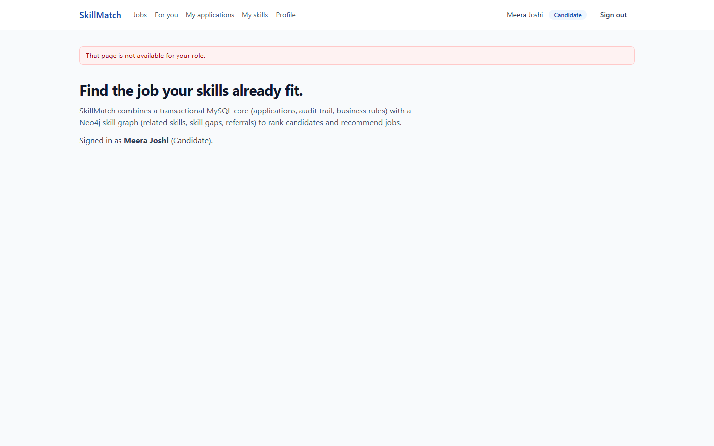 |

More: `home.png`, `job-board-search.png`, `candidate-skills.png`, `admin-users.png`, `admin-skills.png`.

## 11. Testing results

### 11.1 Database test suite: `mysql/06_tests.sql`: **51 / 51 PASS**
Self-checking SQL: each failing statement runs inside a handler and the MySQL error number is compared.

| Group | Tests | Covers |
| :--- | ---: | :--- |
| Constraints | 12 | CHECK (email, blank name, salary, score, experience, website), UNIQUE (email, job+candidate), FK (missing parent, RESTRICT ×2), ENUM |
| Triggers | 14 | closed-job apply, subtype/role checks, immutable role/keys, state machine incl. terminal OFFERED, insert defaults, audit rows, job lifecycle (archived terminal, no recruiter transfer) |
| Procedures / function | 17 | every `sp_submit_application` outcome, owner/admin/candidate/non-owner status changes, invalid status, `fn_match_score` |
| Transactions | 3 | failed submissions leave no rows; an explicit transaction with a failing 2nd statement rolls back the 1st and its trigger side effects |
| Outbox | 4 | events written in-transaction, irrelevant changes emit nothing, deletes emit DELETE |
| Cleanup | 1 | fixtures removed; suite is re-runnable |

### 11.2 Application tests (Vitest, against the real databases): **104 / 104 PASS**

| File | Tests | Highlights |
| :--- | ---: | :--- |
| `auth.test.ts` | 25 | Self-registration as Admin/Recruiter → 403 with no user created; forged / expired / tampered-role / deleted-user tokens → 401; role and ownership checks |
| `admin.test.ts` | 18 | RBAC on every admin route (200/403/403/401); recruiter creation → login → dashboard; unknown company → 422 with user row rolled back; taxonomy changes reach Neo4j |
| `jobs.test.ts` | 16 | FULLTEXT prefix search; operator injection neutralised; filters; SQL score = graph exact score; referral path |
| `constraints.test.ts` | 9 | CHECK / FK violations through the API → 422 and **whole transaction rolled back**; ARCHIVED terminal |
| `db.test.ts` | 9 | OUT parameters never leak between pooled requests; concurrent CALLs isolated; failed CALL leaves no open transaction |
| `sync.test.ts` | 8 | **Replaying the entire outbox twice leaves the graph identical**; poison event blocks then is parked; single-worker lock; drift repaired by rebuild |
| `recruiter.test.ts` | 7 | Dashboard figures; ranking (Kavya ▲, Karthik ▼); status change audited with remarks; invalid transition → 422 |
| `procedures.test.ts` | 6 | Every apply outcome → HTTP status; **3 concurrent identical submits → exactly one 201** |
| `rollback.test.ts` | 6 | CHECK violation in the 2nd UPDATE of the profile rolls back the 1st (users.name) |

### 11.3 Performance: `mysql/05_performance.sql` (50,000 jobs / 100,000 applications)

| Query | With index | Without index |
| :--- | :--- | :--- |
| Newest OPEN jobs (`idx_jobs_status_posted`) | index lookup, **0.16 ms** | full scan + filesort, 16.4 ms |
| One candidate's offers (`idx_apps_cand_status`) | **0.07 ms** | table scan, 22.8 ms |
| A job's pipeline counts (`idx_apps_job_status`) | covering index, **0.02 ms** | table scan + temp table, 19.7 ms |
| Text search, 2 terms | FULLTEXT, cost 0.35 | `LIKE '%…%'` table scan, cost 5,084 (same 714 rows) |

### 11.4 End-to-end and consistency checks
- **Full journeys over HTTP** on a production build: candidate (14 steps), recruiter (14) and admin (12), with 0 server errors.
- **MySQL vs Neo4j:**
  - The scores agree on all 240 job × candidate pairs ([`RANKING_COMPARISON.md`](RANKING_COMPARISON.md)).
  - After every test run, `npm run sync:graph -- --verify` reports **224 / 224 mirrored entries IN SYNC**.
- **Dependencies:** `npm audit` reports 0 vulnerabilities (Next.js upgraded to 16.4.5 for GHSA-mfr8-8qww-v76h).

## 12. Conclusion

SkillMatch shows the database concepts working inside a real application rather than as isolated scripts:
- Integrity rules live in MySQL (constraints, a state machine, ownership inside a procedure), so they hold no matter which code path writes the data.
- Transactions and row locks make concurrent applications safe.
- Triggers produce an audit trail and a sync log that application code can't forget to write.

Neo4j is used where the data is genuinely a graph. The outbox keeps it consistent with MySQL in a way that is measurable and verifiable. Comparing the two rankings shows they **complement** each other: SQL gives exact, explainable shortlists; the graph surfaces adjacent talent and changes the top-5 shortlist for 3 of 12 jobs.

**Limitations and future work:**
- The skill ontology (`RELATED_TO` weights) is curated by hand; it could be learned from co-occurrence in postings.
- The sync worker runs in-process and on demand; a production deployment would run it as a separate service.
- File uploads (resumes) are stored as links, not files.
- Email notifications on status changes are not implemented.

## 13. Individual contributions

The Git history shows each member's commits; each phase was developed on its own branch and merged with `--no-ff`. File ownership is recorded in [`CONTRACTS.md` §7](CONTRACTS.md#7-file-ownership).

| Area | Member A: Sri Pranav Gautam Buduguru (PES1UG24CS466) | Member B: Skanda Shyam Nadig (PES1UG24CS458) |
| :--- | :--- | :--- |
| Infrastructure | Docker Compose, env config, shared contracts | Shared contracts |
| Relational database | Schema, constraints, triggers, procedures, function, views, seed, ALTER/performance/test scripts | n/a |
| Graph database | n/a | Graph model, seed, Cypher queries, outbox sync worker, rebuild/verify |
| Backend / API | Auth (JWT, bcrypt), RBAC, ownership checks, DB access layer, recruiter APIs | Candidate APIs, graph query layer, admin APIs |
| Frontend | Layout, auth pages, recruiter dashboard / job form / applicants | Job board, job detail, candidate pages, admin pages |
| Testing | `06_tests.sql`, auth, db, constraints, recruiter tests | sync, procedures, rollback, jobs, admin tests |
| Documentation | ER diagram, schema, data dictionary | Graph sync design, ranking comparison |

## 14. Requirement → implementation map

| PDF requirement | Implementation |
| :--- | :--- |
| §3 SQL + NoSQL | MySQL 8 + Neo4j 5 |
| §4 ER diagram, keys, constraints | §3–4, [`ER_DIAGRAM_AND_RELATIONAL_SCHEMA.md`](ER_DIAGRAM_AND_RELATIONAL_SCHEMA.md) |
| §4 NoSQL data model, indexes, retrieval | ER doc §6, `neo4j/`, [`GRAPH_SYNC.md`](GRAPH_SYNC.md) |
| §5 CREATE / ALTER / DROP, keys, constraints, indexes, views | `01_schema.sql`, `04_alter_demo.sql` |
| §6 DML, JOIN, GROUP BY, HAVING, ORDER BY, aggregates, subqueries | `03_queries_and_tests.sql`, `lib/*.ts`, §8 |
| §7 ≥ 4 advanced SQL + 1 NoSQL | §7.1 (transactions, procedures/functions, triggers, views, indexing, full-text) + §7.2 (traversal, shortestPath, aggregation) |
| §9 Next.js interface | `web/`, §10 |
| §10 API layer, env-based config | Next.js route handlers; root `.env` only |
| §11 Authentication, ≥ 2 roles | Candidate / Recruiter / Admin; checks in every route |
| §12 DB-level validation and integrity | CHECK / FK / UNIQUE / triggers; screenshots in §10, tests in §11 |
| §13 Documentation | This report + linked docs |
| §14 Git / README | Branch per phase, merged `--no-ff`; [`README.md`](../README.md) |
| §15 Test cases | §11 |
