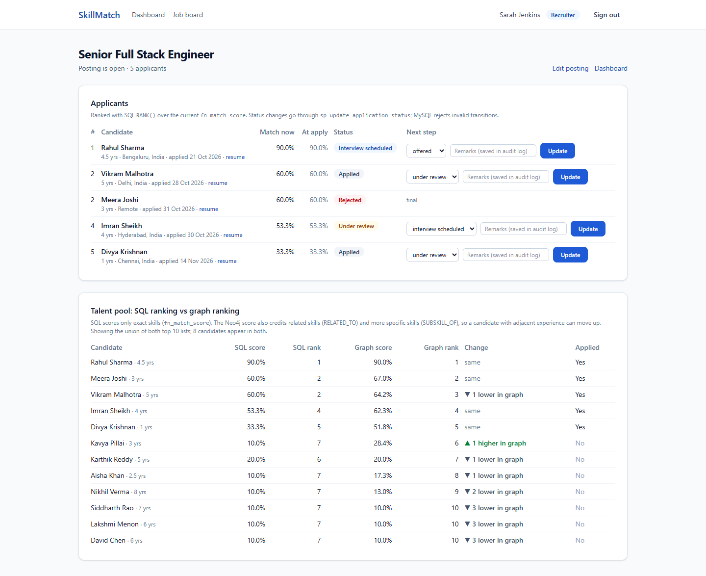

# SQL Ranking vs Neo4j Graph Ranking

SkillMatch ranks candidates for a job in two ways and shows both to recruiters side by side (`/recruiter/jobs/[id]/applicants`). This document explains the difference and reports what it changes on the seeded data.

## 1. The two scores

| | SQL: `fn_match_score` (MySQL) | Graph: `graphScore` (Neo4j) |
| :--- | :--- | :--- |
| Data used | `candidate_skills` ⋈ `job_skills` | `HAS_SKILL`, `REQUIRES_SKILL`, plus the skill ontology `RELATED_TO {weight}` and `SUBSKILL_OF` |
| A skill the candidate has | credit = min(candidate level ÷ required level, 1) | same |
| A required skill the candidate **lacks** | 0 | **0.8** if the candidate has a more specific skill (`SUBSKILL_OF`, ≤ 2 hops, e.g. Next.js → React), otherwise **0.5 × best path weight** over `RELATED_TO` (≤ 2 hops, e.g. GraphQL —0.7— Node.js) |
| Weights | mandatory 2, optional 1 | same |
| Ranking | `RANK() OVER (ORDER BY score DESC)` | same competition ranking, computed in the app |
| Strength | Exact, explainable, always consistent (MySQL is the source of truth) | Finds **adjacent** talent that keyword-exact matching misses |

The graph's `exactScore` (direct skills only) is computed in Cypher with the same formula as `fn_match_score`, which lets the two databases cross-check each other.

## 2. Consistency check

The measurement script ran both stores over **every OPEN job × every candidate (12 × 20 = 240 pairs)**:

| Check | Result |
| :--- | :--- |
| Neo4j `exactScore` = MySQL `fn_match_score` | **240 / 240 identical** |
| Pairs where the graph adds credit (`graphScore > exactScore`) | 109 / 240 (45.4%) |
| Average lift where the graph adds credit | +13.99 percentage points |
| Rank correlation, SQL vs graph (Spearman, per job) | 0.915 – 0.996 |
| Average overlap of the top-5 shortlists | 4.75 / 5 |
| Jobs whose top-5 membership changes | 3 / 12 (jobs 4, 8, 13) |

So the graph doesn't contradict SQL: the rankings are strongly correlated. It reorders candidates near the boundary of the shortlist, where adjacent experience matters most.

## 3. Worked example: job 1, *Senior Full Stack Engineer*

Required: TypeScript (Adv), React (Adv), Next.js (Int), Node.js (Int), all mandatory; MySQL (Int) and Docker (Beg) optional.

| Candidate | SQL score | SQL rank | Graph score | Graph rank | Why the graph differs |
| :--- | ---: | ---: | ---: | ---: | :--- |
| Rahul Sharma | 90.0 | 1 | 90.0 | 1 | Has every mandatory skill; nothing to infer |
| Meera Joshi | 60.0 | 2 | **67.0** | 2 | Missing Node.js (mandatory), but GraphQL is related to it (weight 0.7) → 0.35 credit |
| Vikram Malhotra | 60.0 | 2 | 64.2 | 3 | SQL tie with Meera; the graph separates them |
| Imran Sheikh | 53.3 | 4 | 62.3 | 4 | Related credit for the missing Next.js via React |
| Divya Krishnan | 33.3 | 5 | 51.8 | 5 | Large lift (MERN skills sit next to the stack) but no rank change |
| **Kavya Pillai** | 10.0 | 7 | **28.4** | **6** | Her GraphQL skill is related to Node.js (0.7) and React (0.6), and two hops to Next.js (0.6 × 0.9), adding 1.84 of 10 weighted points: **moves up** |
| Karthik Reddy | 20.0 | 6 | 20.0 | 7 | Java/Spring skills have no related path to the stack: **moves down** |

## 4. When to trust which

- **Shortlisting by hard requirements** (compliance, mandatory certifications): use the **SQL** score. It's exact and transactionally consistent.
- **Sourcing and "who could ramp up quickly"**: use the **graph** score. It surfaces candidates like Kavya, whose related experience a keyword match would miss.
- The graph is **eventually consistent** with MySQL ([`GRAPH_SYNC.md`](GRAPH_SYNC.md)), so a candidate's newest skill may affect the graph score a few seconds after the SQL score.

*Reproduce: the same comparison appears live on the applicants page for every job; per-candidate cross-checks are automated in `web/tests/jobs.test.ts` and `web/tests/recruiter.test.ts`.*
